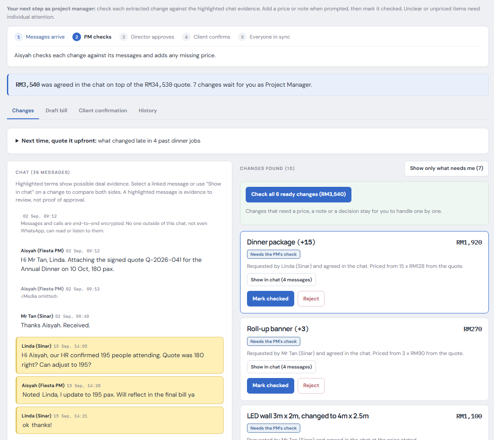
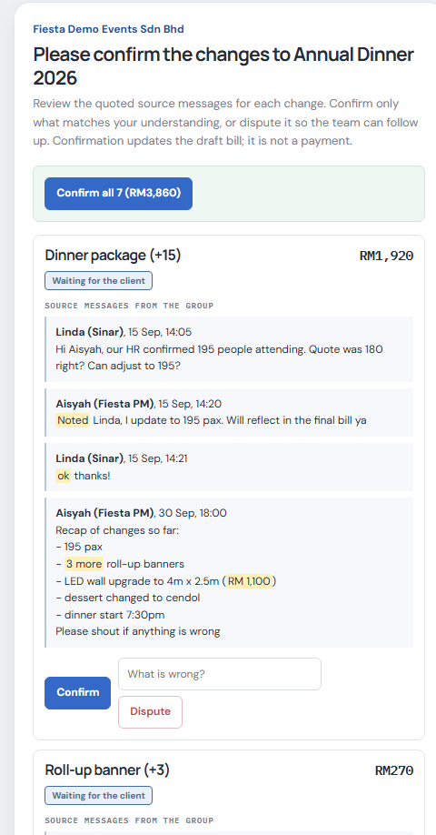
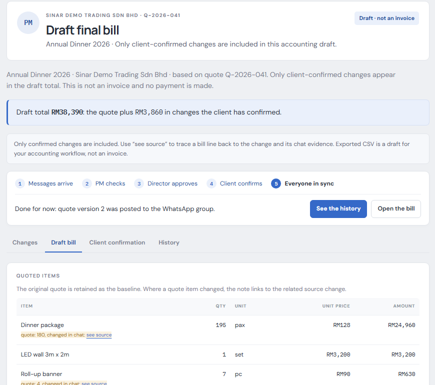

# SMErgers

> Changes agreed in a job's WhatsApp group become approved, traceable changes, a new quote version for everyone, and a correct draft final bill. Built for small event companies first, and for any business that works job by job.

All data in this repository is synthetic. No real chat, person, client or company is used.

---

## Team Information

| Field                 | Details                                          |
| --------------------- | ------------------------------------------------ |
| **Team Name**         | VBall                                            |
| **Team Domain**       | Domain 2: Orbyte Smart SME Challenge             |
| **SDG Track (1–17)**  | SDG 8: Decent Work and Economic Growth (targets 8.2 and 8.3) |
| **Team Leader**       | Vincent Chew Wen Jie                             |
| **University**        | Universiti Sains Malaysia                        |
| **Number of Members** | 3                                                |

## Links

| Resource          | Link                                                                                                                       |
| ----------------- | -------------------------------------------------------------------------------------------------------------------------- |
| GitHub Repository | https://github.com/Anonys-sky/SMErgers                                                                                     |
| Live Demo         | https://sm-ergers-1.replit.app                                                                                             |
| RunPod Endpoint   | https://api.runpod.ai/v2/2y90x5ojwpgxnh (Serverless vLLM; calls need an API key, kept in Replit Secrets)                  |
| Slide Deck        | https://canva.link/yh0xo39bpzxaomf (PDF: [submission/SDC2026_VBall_PitchDeck.pdf](submission/SDC2026_VBall_PitchDeck.pdf)) |
| Demo Video        | https://youtu.be/UKgKFRvKVhM                                                                                               |

---

## Overview

### Problem

A client types in the job's WhatsApp group: *"The LED wall abit small la. Can we upgrade?"* The next morning: *"RM1,100 more."* The client replies: *"ok go ahead."* The quote was signed weeks ago, so that RM1,100 lives only in a chat. Multiply it by every change on an event: 15 more guests, an hour of overtime, two emergency microphones. In our example job, RM3,860 of changes (11.2% of the RM34,530 quote) were agreed in chat and recorded nowhere. At the end, someone scrolls weeks of messages to rebuild the bill, extras go unbilled, and when the client says "I never agreed to that" there is nothing to show, so the owner often gives the money away. The problem comes from a team member's experience at an event company, where it happened on almost every event; it is one person's account, not a survey.

### Solution

- **Catch it.** An AI reader (Llama 3.1 8B on a RunPod GPU, with a rules reader as the fallback) finds each change in the chat: what, how many, what price, and whether both sides agreed.
- **Confirm it.** The project manager checks each change, the project director signs off on large or unusual items, and the client confirms or disputes on their own phone-sized page.
- **Sync it.** Every confirmation creates a new quote version (v2, v3 and so on) and posts a summary back to the group. Only confirmed changes reach the draft bill, and every line links to the messages it came from.

The model only reads. Plain code checks every price, the server enforces who may approve, and nothing reaches the bill without a person's check and the client's confirmation. When something is unclear it does not guess: a change with no price is marked "needs a price", a discount goes to the project director, and a request nobody agreed to stays unconfirmed.

### Key Features

- **Change finder** — finds changes in a messy chat: follow-ups, recaps, withdrawn requests, "let me ask boss first", Malay and Chinese phrasing, per-unit prices and running totals.
- **Evidence beside every change** — every change and bill line highlights the exact messages it came from.
- **Approvals enforced on the server** — the director signs off at RM500 or more, on discounts and on staff-set prices; a client link cannot approve its own change.
- **Client confirmation page** — opened from a WhatsApp link: confirm, or dispute with a reason; a disputed change stays off the bill.
- **Quote versions, draft bill and CSV** — each confirmation makes a new version; the bill is a draft for accounting software, never an invoice.
- **Instant answer, then AI refines** — with the AI reader ticked on a live group, the rules show each change within seconds and the AI improves it in the background, without duplicates and without touching approved work.
- **Real WhatsApp group trigger** — pair a test phone on the **WhatsApp bridge** page and connect a real group to a project: new messages, including ones typed by anyone in the group, are read within seconds, and the log records each arrival. This uses the unofficial whatsapp-web.js library on a test number; production would use Meta's official webhook, which the app already accepts.
- **Add what the reader missed** — a PM adds a change by hand, picking the chat messages that show it was agreed; it goes through the same approval flow and the director always signs it off.
- **Rejection with a reason** — a rejected change stays off the bill, the reason is logged and the other side is told.
- **Per-business approval limit** — each business sets the amount from which the director must sign off (RM500 by default, RM2,000 for the café sample); set it in **Add project**.
- **Measured benefit** — `python src/benefit.py` plays a careful team through the real flow and counts what the reader got right alone, what a person fixed or added, what reached the bill and every human action in the log ([docs/benefit.md](docs/benefit.md)).
- **Tamper-evident activity log** — each entry is chained to the one before, so an edit shows.
- **"Quote it upfront" suggestions** — counts from past jobs show what usually changes late (for example, overtime in 4 of 4 dinners).
- **Role workspaces, guided journey, job API and WhatsApp webhook** — see [Appendix A](#appendix-a-how-it-meets-the-brief).

### Screenshots



*The project manager checks each change against the highlighted chat messages it came from.*



*The client confirms or disputes each change from a link, with no login.*



*The draft final bill: only confirmed changes, every changed line linked to its chat evidence. A draft, never an invoice.*

### Tech Stack

| Layer         | Technology                                                                                   |
| ------------- | -------------------------------------------------------------------------------------------- |
| Frontend      | Server-rendered Jinja templates, one CSS file, a few lines of JavaScript                     |
| Backend       | Python 3.12, Flask                                                                           |
| Database      | In-memory store for the prototype; synthetic JSON data                                       |
| AI / Compute  | Open pre-trained Llama 3.1 8B Instruct (not trained by us): RunPod Serverless (vLLM, GPU), or local Ollama on a company's own machine |
| WhatsApp      | Meta Cloud API webhook format (official); Node.js bridge on whatsapp-web.js for the live demo on a test number (unofficial, not part of the product) |
| Tests         | pytest (350+ tests); Node test runner for the bridge (18 tests)                              |
| Hosting / Dev | Replit (workspace, preview, Deployments)                                                     |

---

## Project Structure

```
.
├── data/                      # Synthetic quotes, chats, answer keys (tuning, held-out, blind and blind2), past jobs, directory
├── docs/                      # results.md (every accuracy run), benefit.md, survey.md, orbyte-integration.md, add-a-project.md, img/
├── runpod/README.md           # Setup for the AI reader's RunPod endpoint (no custom handler needed)
├── scripts/                   # Replit build and start scripts (start the app and the bridge together)
├── src/
│   ├── main.py                # Flask routes: workspaces, job pages, approvals, client page, bill, API, webhook, bridge, import
│   ├── reader.py              # Chooses the reader: AI first (if asked), rules as the fallback
│   ├── rules_extractor.py     # Rules reader (default, instant, no network)
│   ├── llm_extractor.py       # AI reader: prompt, plain-code checks of the answer, price recovery, second "what is missing?" pass
│   ├── workflow.py            # Approval state machine, roles, per-business approval limit, hash-chained activity log
│   ├── sync.py                # Quote versions and the outbox of messages back to the group
│   ├── bill.py                # Draft bill from confirmed changes only
│   ├── benefit.py, evaluate.py# Measured benefit report and accuracy scoring against answer keys
│   ├── store.py, workspaces.py, project_intake.py, catalogue.py   # Jobs in memory, role dashboards, Add project, quote and rate card
│   ├── chat_import.py, webhook.py, whatsapp_bridge.py             # Chat export, Meta webhook format, bridge client
│   ├── suggest.py             # "Quote it upfront" counts from past jobs
│   └── templates/, static/
├── submission/                # Required submission documents
├── tests/                     # pytest suite
├── whatsapp/                  # WhatsApp bridge (Node.js, whatsapp-web.js): pairs a test phone, reads a real group
├── .env.example, .replit, requirements.txt, package.json, replit.md
└── LICENSE, README.md
```

### Architecture

```
 WhatsApp group (test number, via the bridge)      Meta Cloud API webhook (official format)      .txt export
                         \                                   |                                    /
                          +-----------------> messages, each arrival logged as a trigger <---------+
                                                         |
                READER   rules (default)   or   AI reader: open Llama 3.1 8B (RunPod, or the company's own machine)
                         inputs: signed quote, rate card, company directory, past jobs
                         plain code checks every price and status; the model only reads
                                                         |
                APPROVALS (state machine, roles enforced on the server)
                         PM checks, prices, rejects with a reason, adds what the reader missed
                         Director signs off from the business's own limit, all discounts and staff-set prices
                         Client confirms or disputes from a link, no login
                                                         |
                OUTPUTS  quote v2 + message back to the group, draft bill and CSV,
                         read-only JSON API (/api/jobs), hash-chained activity log, benefit report
```

**Reader failover, and instant answers.** For a live WhatsApp group that asked for the AI reader, the rules read each new message at once (about 3 seconds from phone to screen) and the AI refines the answer in the background: it updates untouched items in place, adds what it alone found, and never changes anything a person already acted on (`Job.reconcile`). If the AI cannot be reached (RunPod asleep, no key, network down) the rules answer simply stays, one line says so in the activity log, and an AI call never waits more than 60 seconds. The demo never depends on the model.

**Where things are decided.** The model proposes. Plain code in `llm_extractor.build_changes` accepts a price only if it is written in the chat or the quote, and sets every status. The server (`workflow.py`) decides who may approve; the browser only hides buttons.

**Design limits we know about.** Data is in memory and resets on restart. Sign-in is simulated (roles are enforced, identities are not). The WhatsApp bridge is unofficial and for test numbers only; production needs Meta's official API. `main.py` holds all routes in one file, which is fine at this size and would be split by feature before a pilot.

---

## How to Run

### Option 1: Run on Replit (Recommended)

1. Import this repository via **Create Repl → Import from GitHub**.
2. Optional, only for the AI reader: open the **Secrets** tab and add the variables listed in `.env.example`: `RUNPOD_API_KEY` and `RUNPOD_ENDPOINT_ID`. Without them the rules reader is used.
3. Click **Run**. The `.replit` workflow starts Flask on port 5000 (and the optional test connector on loopback port 3001) using `scripts/start-application.sh`.

The deployed demo is at https://sm-ergers-1.replit.app. After changing settings, **republish**: restarting the workspace does not update the published deployment.

### Option 3: Run the live WhatsApp demo on another laptop

Step-by-step setup (two phones, pairing, the scripted demo conversation) is in [docs/demo-setup.md](docs/demo-setup.md). A tick-box test sheet for the second laptop is in [docs/test-checklist.md](docs/test-checklist.md). The scripted conversation lives in `data/demo_group_script.json`, and `tests/test_demo_script.py` proves it gives the same five changes every time.

### Option 2: Run Locally

```bash
# 1. Clone the repository
git clone https://github.com/Anonys-sky/SMErgers.git
cd SMErgers

# 2. Create and activate a virtual environment
python -m venv venv
source venv/bin/activate        # Windows: venv\Scripts\activate

# 3. Install dependencies
pip install -r requirements.txt

# 4. Configure environment variables (all optional)
cp .env.example .env            # then fill in your values

# 5. Run the app
python src/main.py              # then open http://localhost:5000
```

The app opens on the Project manager workspace with four synthetic projects. State is kept in memory; **Reset demo data** restores the samples.

### Run Tests

```bash
python -m pytest                # 350+ tests: parsing, rules, permissions, billing, pages
npm test                        # bridge conversion tests (needs Node.js)
```

### Three-minute demo walkthrough

0. To see the automatic trigger, open **WhatsApp bridge**, pair a test phone, and connect a group to a project: messages sent in the group appear within seconds (needs both the app and the bridge running; otherwise use **Import chat**). You can type a message in the group yourself.
1. In the Project manager overview, open **Annual Dinner 2026**. The chat is on the left, the changes found in it on the right.
2. You are Aisyah, the PM. Click **Show in chat** on the LED wall upgrade: the request, the price and the "ok go ahead" light up.
3. The wireless mics have no price anywhere, so they show **Needs a price**. Set RM320 (the director must now approve it), then **Check all**.
4. Press **Continue as Daniel (Project Director)**, then **Approve all**.
5. Press **Open the client's link**, the page the client sees from WhatsApp. Confirm all seven changes, or dispute one with a reason and it stays off the bill.
6. Press **Back to Aisyah**, then open **Activity log** (quote version 2 posted to the group) and **Draft bill** (every line linked to its source).

To try the AI reader, open **Import chat**, choose `data/chats/blind_agent_a.txt` with its quote `q_blind_agent_a.json`, and tick **Read with the AI reader**.

---

## How We Use Replit *(Required)*

Replit is where the team designs, tests and deploys SMErgers.

- **Development:** the interface and logic are built and iterated in the Replit workspace, with the live preview beside the code. Replit Agent helped with run configuration, deployment publishing, startup scripts and tests (declared in the Technical & Tools Declaration).
- **Testing:** the app runs in Replit's preview and the test suite runs in its shell (`python -m pytest`); `requirements.txt` pins the dependencies so Replit matches the local build.
- **Hosting:** the app is deployed with Replit Deployments at the Live Demo link above; `.replit` starts the app on port 5000.
- **Secrets:** `SECRET_KEY` and the AI reader's RunPod keys are stored in Replit Secrets, never in the code.

📄 Proof of use: [`submission/SDC2026_VBall_Replit_POU.pdf`](submission/SDC2026_VBall_Replit_POU.pdf)

## How We Use RunPod *(Required)*

The AI reader's model runs on a RunPod Serverless endpoint, not on Replit. RunPod runs a pre-trained model only: we train and fine-tune nothing.

- **Workload:** inference with Llama 3.1 8B Instruct on an RTX 4090, through RunPod's ready-made vLLM worker (`runpod/worker-v1-vllm`). No custom handler is needed; the worker exposes an OpenAI-compatible API.
- **Setup:** steps and lessons in [runpod/README.md](runpod/README.md). Settings: min workers 0, max workers 1, idle timeout 30 s.
- **Integration:** the Replit app sends the chat text to the endpoint with `RUNPOD_API_KEY` and `RUNPOD_ENDPOINT_ID`, only when a chat is imported with **Read with the AI reader** ticked. If the endpoint is down, the rules read the chat and the page says so. After a quiet period the first request takes 2 to 3 minutes while the GPU worker starts.

Example request:

```bash
curl -X POST https://api.runpod.ai/v2/$RUNPOD_ENDPOINT_ID/openai/v1/chat/completions \
  -H "Authorization: Bearer $RUNPOD_API_KEY" \
  -H "Content-Type: application/json" \
  -d '{"model": "meta-llama/Llama-3.1-8B-Instruct", "messages": [{"role": "user", "content": "Hello"}]}'
```

📄 Proof of use: [`submission/SDC2026_VBall_Runpod_POU.pdf`](submission/SDC2026_VBall_Runpod_POU.pdf)

---

## Challenges & Learnings

- **Our first accuracy scores were contaminated.** One author wrote the chats, the keys and the rules, so 20 of 20 meant nothing. On three chats written blind by separate AI agents, the rules fully got 13 of 29 changes right and the AI reader 17 (21 after we fixed its errors, on the same chats, so not independent). See [Appendix C](#appendix-c-testing-and-results).
- **WhatsApp limits shape the design.** The official Groups API allows at most 8 people per group and needs a verified business, so the prototype uses the official webhook format and imports chats from a text export.
- **A model should read, not decide.** The AI reader only reports what it found; code rejects invented prices and a person approves every change.
- **Cold starts matter.** A serverless GPU worker takes minutes to wake, so the app always has a rules fallback.

## Future Improvements

- [ ] Score the AI reader on chats written by our teammates, and time the final bill by hand against SMErgers.
- [ ] Pilot with 3 to 5 event companies on the official WhatsApp API, with consent.
- [ ] Reuse Orbyte approvals and eSign; train a model on real, human-checked approvals.
- [ ] Extend to renovation, agencies and print; vendor quote comparison; turn a client's photo into a change.

## Team

| Name                    | GitHub                                              |
| ----------------------- | --------------------------------------------------- |
| Vincent Chew Wen Jie    | [@Anonys-sky](https://github.com/Anonys-sky)        |
| Steven Elnathan Meliala | [@stevenmeliala](https://github.com/stevenmeliala)  |
| Looi Wan Wei            | [@wan-wei-looi](https://github.com/wan-wei-looi)    |

---

## Submission Checklist

- [x] Team name, domain (Domain 2) and SDG track filled in
- [x] Slide deck link added
- [x] Demo video link added
- [x] Replit used, with proof of use in `submission/`
- [x] RunPod used, with proof of use in `submission/`
- [x] Preliminary submission completed (`SDC2026_VBall_Preliminary Proposal.pdf`)
- [x] Technology declaration completed (`SDC2026_VBall_TechDeclaration.pdf`)
- [x] Submission files renamed with the team name
- [x] "How to Run" steps verified
- [x] No API keys or secrets committed to the repository

---

## Appendix A: How it meets the brief

**The five-step Domain 2 journey:**

| Step | In SMErgers |
| --- | --- |
| Trigger | A message arrives in the job's WhatsApp group (webhook), or a chat export is imported in the prototype |
| Connected data | The signed quote, rate card, client, job and company directory |
| Decision logic | Rules, or an AI reader for messy chats, find each change, its quantity and price, and whether both sides agreed |
| Human approval | PM checks; project director signs off on large or unusual items; client confirms |
| Visible outcome | Quote v2 posted to the group, the draft bill and CSV, and the activity log |

**The six must-have features:**

| Must-have | Where to see it |
| --- | --- |
| One clear SME problem | Agreed changes in WhatsApp never reach the final bill ([Problem](#problem)) |
| Core automated journey | The five steps above, running in the [demo walkthrough](#three-minute-demo-walkthrough) |
| Accuracy and ease of learning | Evidence beside every change, a five-step guide, and measured scores ([results](#appendix-c-testing-and-results)) |
| People stay in control | Role checks on the server and the hash-chained log (`src/workflow.py`, `tests/`) |
| Orbyte fit and reuse | Reuses Orbyte's roles, approvals, eSign and audit trail and adds chat-to-approved-changes. The same engine runs a café renovation chat with only a different quote file, and the job API is a building block ([docs/orbyte-integration.md](docs/orbyte-integration.md)) |
| Business benefit and SDG | Extras recovered and hours saved; SDG 8.2 and 8.3 ([Appendix D](#appendix-d-business-model-privacy-and-limits)) |

## Appendix B: Where AI fits, configuration and API

The chat-reading step has two readers behind one interface (`src/reader.py`):

- **Rules reader** (default): fixed, explainable rules. Fast, offline, and the fallback.
- **AI reader**: Llama 3.1 8B Instruct on a RunPod GPU, used as it is. It only reads: it finds the changes and cites the messages. Plain code then rejects any price not written in the cited messages or the quote, and sets every status itself. Three code guards sit on top of the prompt: a price promised "later" is never filled in from the quote, a colour or time swap with no price is logged as no cost, and a change whose last message is "let me ask my boss first" cannot be ready. Approval and billing never use the model.

Every approval and dispute is a human-checked label; after a pilot with real companies that data can train a model. We do not train on made-up chats.

**Configuration.** All settings are environment variables and none is required to run the demo. On Replit, set them in **Secrets**. Never commit real values (`.env.example` lists them).

| Variable | Purpose | Default |
| --- | --- | --- |
| `PORT` | Port the app listens on | `5000` |
| `SECRET_KEY` | Signs the cookie that remembers which role you are viewing as | random at start-up |
| `SMERGERS_READER` | `llm` makes the AI reader the default for every job | `rules` |
| `RUNPOD_ENDPOINT_ID`, `RUNPOD_API_KEY` | Use the AI reader on a RunPod Serverless endpoint | unset: local Ollama |
| `SMERGERS_KEEP_APP_UP` | Set to `1` with `npm start` to keep the app serving if only the WhatsApp bridge stops | off (both services stop together) |
| `SMERGERS_LLM_URL`, `SMERGERS_LLM_MODEL`, `SMERGERS_LLM_KEY`, `SMERGERS_LLM_TIMEOUT` (seconds per call, default 60; use 900 for scoring on a slow laptop) | Point the AI reader at any OpenAI-compatible endpoint | RunPod or Ollama; timeout `300` s |
| `WHATSAPP_VERIFY_TOKEN`, `WHATSAPP_APP_SECRET` | Webhook handshake token; when the secret is set, every call must carry a valid `X-Hub-Signature-256` | unset |
| `WHATSAPP_BRIDGE_URL`, `WHATSAPP_TIMEZONE` | Optional test connector (unofficial, not part of the product) | `http://127.0.0.1:3001`, system zone |

**Job API.** `GET /api/jobs` lists the jobs (with each business's sign-off limit) and `GET /api/jobs/<job_id>` returns one job as JSON (read-only, a building block for Orbyte modules):

```bash
curl http://localhost:5000/api/jobs
curl http://localhost:5000/api/jobs/annual-dinner
```

**WhatsApp webhook** (Meta Cloud API format): `GET /webhooks/whatsapp` echoes `hub.challenge` when `hub.verify_token` matches `WHATSAPP_VERIFY_TOKEN`, otherwise 403. `POST /webhooks/whatsapp` accepts Meta's payload and returns 403 if the signature is invalid. The group id is read from a `group_id` field on each message, which is our assumption because we had no API access; check it against Meta's Groups API documentation before going live. The default demo has no linked group, so chats come in by text export.

**Optional test connector.** `whatsapp/` holds an unofficial WhatsApp Web connector, used for team testing only and not part of the product. Use a spare test number and synthetic groups, never real client conversations. Open `/whatsapp` to pair it. On the published Replit VM, `scripts/build-production.sh` installs the Node dependencies and checks that Chromium launches, and `scripts/start-application.sh` runs Flask and the connector together. Demo role selection is not authentication, so make the deployment private before pairing an account.

## Appendix C: Testing and results

```bash
python -m pytest                              # 350+ tests
python src/evaluate.py                        # score the rules against the answer keys
python src/evaluate.py --blind --ai           # also score the AI reader (needs a model endpoint)
```

A change is fully right when both its status and its price match the hand-written answer key. The rules scored 10 of 10 and 20 of 20 on chats written by the same author as the rules, which is **not** an accuracy figure.

**Blind chats.** Three chats, their quotes and answer keys were written by separate AI agents that never saw the extractor, and committed before any scoring ([docs/results.md](docs/results.md), Runs 2 to 6; Runs 7 and 8 below):

| Reader | Found | Fully right | False changes |
| --- | --- | --- | --- |
| Baseline (any message with an RM amount) | 15 of 29 | 3 | 5 |
| Rules | 22 of 29 | 13 | 3 |
| AI reader on RunPod | 26 of 29 | **17** | 1 |
| AI reader after fixing the errors seen in that run (same chats, so optimistic, not independent) | 26 of 29 | 21 | 0 |

**Second blind set (Runs 7 and 8, 28 Oct).** Four more chats, 36 changes, written by independent agents and committed before scoring; nothing was tuned on them. The AI reader was run once on CPU-only local Ollama (same Llama 3.1 8B):

| Reader | Found | Fully right | False changes |
| --- | --- | --- | --- |
| Rules | 27 of 36 | 8 (22%) | 1 |
| AI reader | 33 of 36 | **27 (75%)** | 1 |

**After a round of fixes (Runs 9 and 10, 31 Oct): a development score, not independent.** We studied the AI reader's mistakes on these same chats and added plain-code checks (finding a price stated next to the cited messages, a second "what is missing?" pass, "price to confirm" read per item, a cancelled request caught). Same model, same laptop, old code against new code:

| Set | Before | After (same chats, **not independent**) |
| --- | --- | --- |
| Set 1, 29 changes | 20 (69%) | 21 (72%) |
| Set 2, 36 changes | 27 (75%) | 33 (92%) |
| Both, 65 changes | 47 (72%) | 54 (83%) |

The independent numbers stay 59% and 75% until the new reader is scored on a third set of chats nobody has seen. Details and what is still wrong: [docs/results.md](docs/results.md), Runs 9 and 10.

Both sets are synthetic chats: a first independent check, not accuracy on real chats. The log lists where the AI reader is still wrong, which is why a person checks every change.

## Appendix D: Business model, privacy and limits

The owner pays, because the owner is the one giving money away. A B2B freemium subscription, with prices as hypotheses to test in a pilot:

| Tier | Price | Includes |
| --- | --- | --- |
| Capture | Free | One active job, find and list changes |
| Confirm | RM100 a month | Approvals, client confirmation links, group updates |
| Settle | RM250 a month | Draft bills, CSV, log export, suggestions, all jobs |

Worked example from one simulated job: RM3,860 of extras on a dinner, times 10 dinners a year, is RM38,600. Winning back a quarter is RM9,650 against the RM1,200 a year Confirm tier: a net gain of RM8,450, 7.0 times the cost. Break-even is about 3% of extras. The real rate is unknown, so the pilot measures it.

- **Synthetic data only.** Every chat, quote, company and person here is invented and labelled.
- **No payments, filings or advice.** The bill is a draft for accounting software; nothing is sent or paid.
- **Sign-in is simulated,** as the brief allows; permissions are still checked on the server.
- **PDPA in a real deployment:** tell clients and vendors why the group is read, keep only messages linked to changes, limit access by role, set a retention period, honour access and deletion requests, and get legal review before a pilot.
- **Limits:** data is held in memory and resets on restart; group messages are queued and shown on screen, because delivery needs the official WhatsApp API; the rules and the AI reader can miss unusual phrasing, which is why nothing reaches the bill without a person's check and the client's confirmation.

## Contributing

- Commit in small steps with a clear message; each feature comes with tests.
- Run `python -m pytest` before pushing; all tests must pass.
- Use synthetic data only, and never commit secrets or a real `.env`.
- Keep the approval rules on the server: a hidden button is not a permission check.
- Record every accuracy run in [docs/results.md](docs/results.md), including bad ones, and never tune on the blind chats.

---

## License

This project is licensed under the [Apache License 2.0](LICENSE).

**Built with Llama.** The AI reader uses Meta Llama 3.1 8B Instruct under the Llama 3.1 Community License. Llama 3.1 is licensed under the Llama 3.1 Community License, Copyright © Meta Platforms, Inc. All Rights Reserved.

Third-party software: Flask, Jinja2, MarkupSafe and Werkzeug (BSD-3-Clause), tzdata (Apache-2.0), pytest (MIT), vLLM (Apache-2.0), Ollama (MIT), and, for the optional test connector only, whatsapp-web.js (Apache-2.0) and qrcode (MIT). Full list with versions: `requirements.txt`, `package.json` and the Technical & Tools Declaration.
